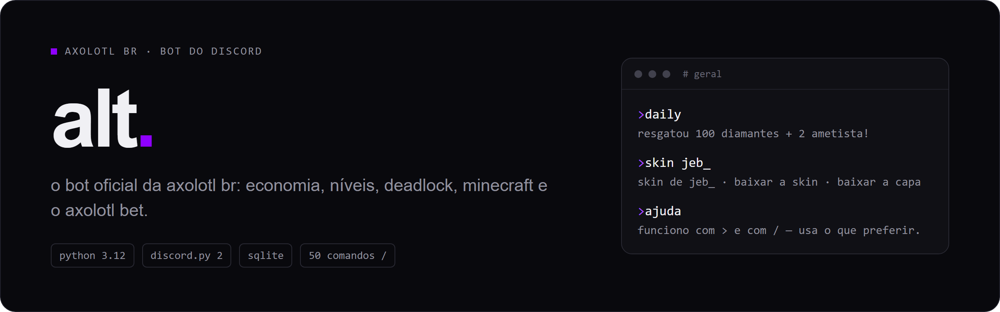

<p align="center">
  
</p>

o bot oficial da **axolotl br**, a comunidade de player pra player. todo comando `>` tem
um gêmeo `/` com o mesmo nome (aliases só no `>`). `>ajuda` mostra tudo por categoria.

## comandos

| sistema | comandos |
|---|---|
| geral | `>ajuda` `>axolotl` `>ping` · responde `w` · oi do dia (1 por pessoa) |
| servidor | `>server` (hub da comunidade) · `>player` (`>perfil` vale) · `>quests` (diárias e streak) |
| níveis | `>xp` · `>ranking` |
| economia | `>saldo` · `>daily` (100 diamantes + 2 ametista, vira à meia-noite) · `>pay` · `>topdima` |
| loja | `>loja` · `>buy` · `>equipar` (`>aura` vale) · `>auras` · `>roll` (5 ametista) · `>box` (150 diamantes) · `>caixarara` (15 ametista) · `>colecao` |
| axolotl bet | `>bet` (hub) · `>slots` · `>caraoucoroa` · `>mines` — aposta de 1 a 1000 em diamante ou ametista |
| jogos | `>ptp` (sem nada abre o hub) · `>placar` · `>rankingptp` |
| deadlock | `>deadlock` · `>vincular` · `>desvincular` · `>stats` (`1d` ou `7d`) · `>rank` |
| minecraft | `>minecraft <nick>` (perfil) · `>skin <nick>` (skin inteira pra baixar) |
| osu! | `>osu` (`>osu mania`, `taiko`, `catch`) |
| mudae | aviso sozinho quando os rolls voltam · `>mudae <min>` · `>mudae_stop` |
| voz | `>call` · `>sair` · `>oi` (toca o oi de quem entra na call) |
| tickets | painel com denúncia, bug e outra · `>fecharticket` · `>addticket` |

admin: `>setxp` `>dar` `>halvdima` `>resetuser` `>backup` `>setupticket` `>github` `>restart`.

sozinho, sem comando: digest das diárias às 00:00, backup do banco às 04:00 (guarda 7),
commit da branch principal dos repos no chat e status rotativo, com deadlock sempre na roda.

## rodar

```bash
python -m venv .venv
.venv\Scripts\activate
pip install -r requirements.txt
copy .env.example .env   # preenche o TOKEN no mínimo
python main.py
```

no developer portal, liga os intents `members` e `message_content`. o resto das variáveis
tá explicado no `.env.example`. testes: `python -m pytest`.

## deploy

a shardcloud puxa da `main` sozinha a cada push. o banco mora em `/app/data/alt.db` e
não vai pro git. a versão do bot fica em `VERSAO` no `main.py` e aparece no log de boot.

---

parte do ecossistema **axolotl br**. © 2020 – 2026.
